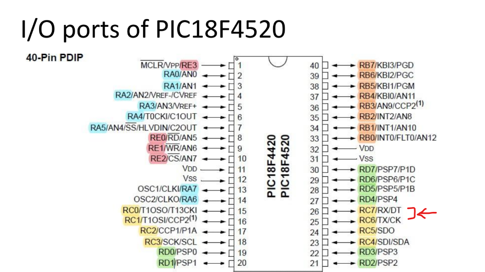

# PIC18F4520 TinyML Handwritten Digit Recognition (UART Demo)

在 8 位元微控制器 **PIC18F4520**（32 KB Flash、1.5 KB SRAM、無 FPU）上實作純整數 **INT8 量化多層感知器（MLP）**，完成 0–9 手寫數字即時辨識。

## 專案特色

- **極輕量模型架構**：`64 → 16 → 10` 全連接網路，輸入為 8×8 4-bit 灰階影像（數值 `0–16`）。
- **零浮點推論**：權重以 `const int8_t` 存放於 Flash（僅約 **1.2 KB**），推論全程使用整數乘加與位元右移（`L1_SHIFT = 7`）。
- **高量化保真度**：於 `scikit-learn digits` 測試集上，INT8 純整數推論準確率達 **98.22%**（與 FP32 浮點模型無損一致）。
- **完整除錯介面**：電腦端提供 Tkinter 粗筆刷手寫畫布、8×8 灰階區域平均縮放預覽，以及「官方測試樣本」一鍵驗證按鈕。

## 目錄結構

```text
pic18f4520-tinyml-digit/
├── firmware/
│   ├── main.c              # PIC18F4520 (XC8) UART 接收與純整數 MLP 推論
│   └── weights.h           # 量化後的 INT8 權重陣列 (存放於 Flash)
├── pc_client/
│   ├── pc_demo.py          # Python Tkinter 手寫介面與序列埠傳輸
│   └── requirements.txt    # pyserial 相依套件
├── training/
│   └── train_export.py     # 模型訓練與 INT8 量化驗證腳本
└── README.md
```

## 硬體接線圖（PIC18F4520 40-pin PDIP）

```text
                               PIC18F4520 (40-pin PDIP)
                              +-----------+-----------+
        +5V ──[10kΩ]──┬───────┤ 1  MCLR        RB7 40 ├─────> PICkit 4 Pin 4 (PGD)
    PICkit 4 Pin 1 ───┘       │                RB6 39 ├─────> PICkit 4 Pin 5 (PGC)
                              │                       │
  +5V ──┬───[0.1µF]─── GND    │                VDD 32 ├─────> +5V ──┬──[0.1µF]── GND
        └─────────────────────┤ 11 VDD         VSS 31 ├─────> GND ──┘
  GND ────────────────────────┤ 12 VSS                │
                              │                RC7 26 ├<───── USB-to-TTL TXD
                              │                RC6 25 ├─────> USB-to-TTL RXD
                              +-----------------------+
```

### 接線對照表

| 外部裝置 | 裝置腳位 | PIC18F4520 腳位 | 說明 |
| :--- | :--- | :--- | :--- |
| **USB-to-TTL** | `RXD` | Pin 25 (`RC6 / TX`) | **交叉對接** |
| | `TXD` | Pin 26 (`RC7 / RX`) | **交叉對接** |
| | `GND` | Pin 12 / 31 (`VSS`) | 務必與電路共地 |
| **PICkit 4** | Pin 1 (`MCLR`) | Pin 1 (`MCLR`) | 透過 10 kΩ 上拉至 +5V |
| | Pin 2 (`VDD`) | Pin 11 & 32 (`VDD`) | 兩組電源腳皆須連接 |
| | Pin 3 (`VSS`) | Pin 12 & 31 (`VSS`) | 兩組接地腳皆須連接 |
| | Pin 4 (`PGD`) / Pin 5 (`PGC`) | Pin 40 (`RB7`) / Pin 39 (`RB6`) | ICSP 燒錄介面 |

> **供電提醒**：PICkit 4 與 USB-to-TTL 的 `5V` 請**擇一供電**，切勿同時接上兩組 5V 電源。

## 通訊協定

- **格式**：`9600 bps`、`8N1`（PIC18 採用 4 MHz 內部震盪器，`BRGH = 1`、`SPBRG = 25`）
- **PC → PIC18**：`[0xAA]`（1 byte 起始碼）+ `[64 bytes 像素值，範圍 0–16]`
- **PIC18 → PC**：`1 byte` ASCII 字元（`'0'`–`'9'`）

## 快速開始

### 1. 燒錄韌體（MPLAB X + XC8）
1. 在 MPLAB X 建立 PIC18F4520 專案，選擇 XC8 編譯器。
2. 將 `firmware/main.c` 與 `firmware/weights.h` 加入專案並燒錄至晶片。

### 2. 執行電腦端手寫介面
```bash
cd pc_client
pip3 install -r requirements.txt
```
查詢序列埠名稱（macOS 使用 `ls /dev/cu.*`；Windows 至裝置管理員查看 `COMx`），修改 `pc_demo.py` 中的 `PORT` 後執行：
```bash
python3 pc_demo.py
```
1. 先點擊 **「測官方樣本」**，確認 PIC18 能正確辨識 0–9 測試樣本。
2. 於左側黑底畫布手寫數字，按下 **「送出辨識」** 即可查看 PIC18 回傳結果。
